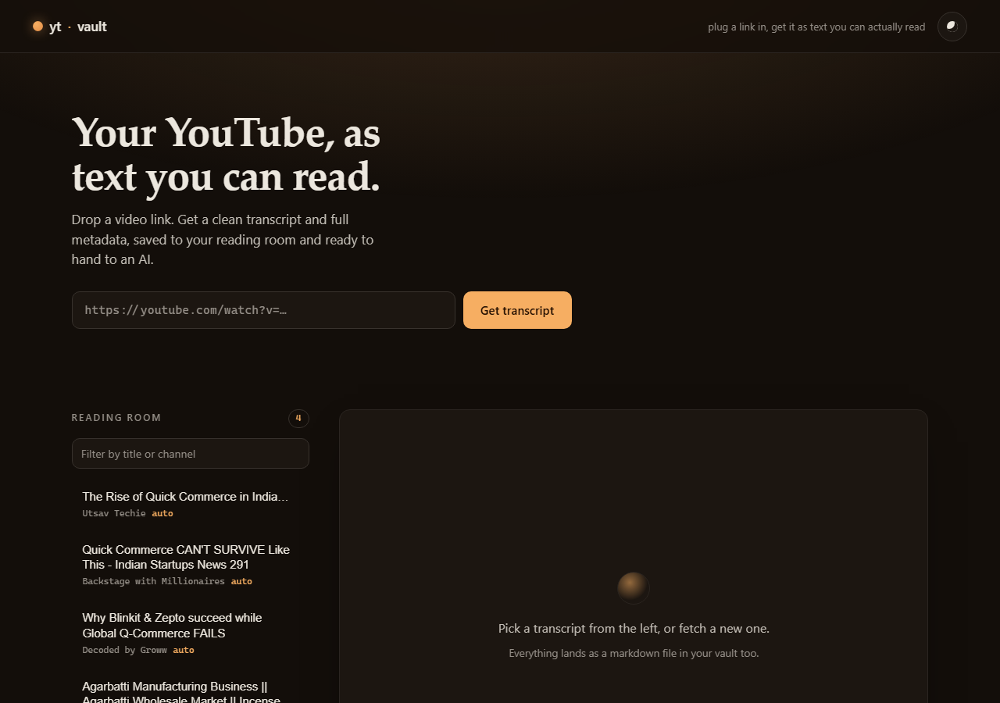

# yt-vault

Turn any YouTube link into a clean transcript you can actually read, and that you can hand
straight to an AI. A small CLI plus a warm reading-room web app. Built on `yt-dlp`.
Public data only (metadata + captions), no login, no personal data.



---

## What it does

- **Fetch** a video by URL or id → metadata + transcript, written as one markdown note per video.
- **Read** everything in a calm reading room: serif body, comfortable measure, warm dark or paper light.
- **Plug into AI**: one click copies a title + channel + transcript block ready to paste into a model.

Notes are plain markdown with YAML frontmatter, so they drop straight into Obsidian / any vault.

---

## Install

Requires Python 3.12+ and [uv](https://docs.astral.sh/uv/).

```bash
cd yt-vault
uv sync          # installs all dependencies from pyproject.toml / uv.lock
```

Dependencies (managed in `pyproject.toml`):

| Package | Why |
|---|---|
| `yt-dlp` | search, metadata, caption download |
| `requests` | transport |
| `fastapi` | web API |
| `uvicorn` | ASGI server |

---

## Run the web app

```bash
uv run python server.py
# → http://127.0.0.1:8765
```

Paste a YouTube URL, hit **Get transcript**, read it. Saved transcripts appear in the
reading room on the left. Toggle dark / paper with the dot in the top-right.

## Use the CLI

```bash
uv run python yt.py search "indian incense market" -n 10   # list results
uv run python yt.py get https://youtu.be/VIDEO_ID          # one video → note
uv run python yt.py grab "agarbatti business" -n 5         # search + fetch top N
uv run python yt.py index                                  # rebuild INDEX.md
```

---

## Where notes live

Default: `./library/` (a self-contained store) plus `INDEX.md`. Point it anywhere:

```bash
uv run python yt.py --out "C:\Personal\Aethion\_raw\youtube" grab "..." -n 5
# or set once for both CLI and server:
set YT_VAULT_DIR=C:\Personal\Aethion\_raw\youtube
```

`library/` contents are gitignored (your data); the folder is kept via `.gitkeep`.

---

## Transcripts and the 429 wall

Transcripts use yt-dlp's own caption downloader (json3), which adds the params YouTube now
requires. YouTube rate-limits caption fetches per IP, so heavy bursts can return `HTTP 429`.
Built-in mitigations: retries, request pacing (`grab --sleep`), the `android` player client,
and partial-download tolerance (a 429 on a secondary language never discards the English one
that already downloaded). If you still hit 429:

- wait for the IP cooldown, or
- pass browser cookies: `--cookies-from-browser firefox` (Firefox is most reliable; recent
  Chrome builds fail with a DPAPI decrypt error), or set `YT_VAULT_COOKIES=firefox`.

Metadata and the note always save; only the transcript field needs the caption endpoint.

---

## Design

Warm, low-glare reading surface ("evening lamp" dark by default, "paper" light on toggle).
One ember accent, used sparingly. Three type roles: a serif for the transcript body (long-form
legibility), a system sans for UI chrome, a mono for metadata. Reading column capped near 66ch
with generous leading. Motion is restrained and respects `prefers-reduced-motion`. OKLCH tokens
in `web/style.css`.

## Project layout

```
yt-vault/
├── yt.py            # CLI: search / get / grab / index
├── server.py        # FastAPI app + JSON API
├── web/
│   ├── index.html   # app shell
│   ├── style.css    # tokens + reading-room styling
│   └── app.js       # fetch, render, theme, copy-for-AI
├── library/         # generated notes (gitignored, .gitkeep tracked)
├── pyproject.toml
└── uv.lock
```

## API

| Method | Route | Returns |
|---|---|---|
| GET | `/api/library` | saved transcripts (metadata) |
| GET | `/api/note/{file}` | one transcript (full) |
| POST | `/api/fetch` `{url}` | fetch a video, save its note, return it |
