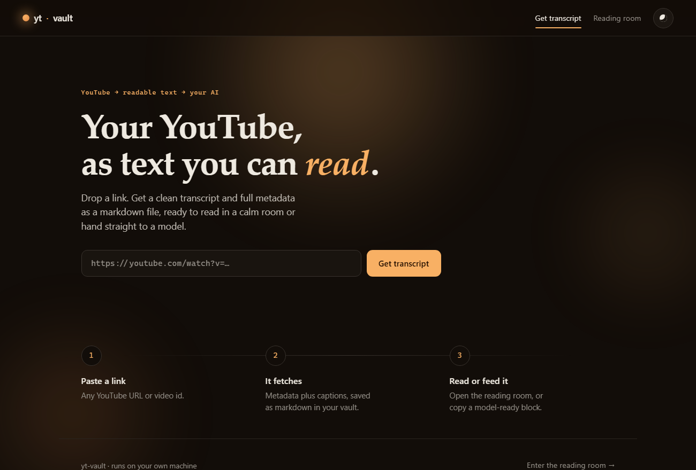
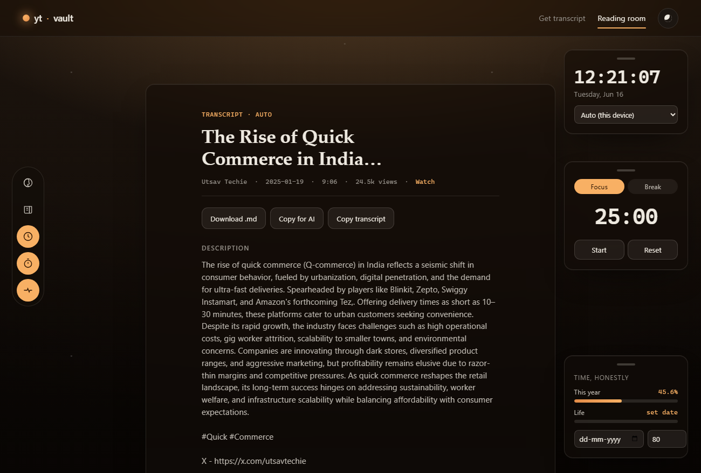

<div align="center">

# yt-vault

**Turn any YouTube link into a clean transcript you can actually read — and hand straight to an AI.**

A tiny self-hosted tool: paste a link, get a markdown transcript, then read it in a cozy,
customizable reading room with scenes and focus widgets. Runs entirely on your own machine.





</div>

---

## Why

YouTube hides a lot of good thinking inside videos you don't have 40 minutes for. yt-vault pulls
the transcript and metadata, saves it as a plain markdown file in a folder you own, and gives you
two calm places to use it: a clean **getter** and a **reading room** you can make your own.

- **Yours.** Runs on `127.0.0.1`. No accounts, no tracking, public data only (metadata + captions).
- **Portable.** Every video becomes a markdown file with YAML frontmatter, so it drops into Obsidian or any vault.
- **AI-ready.** One click copies a title + channel + transcript block to paste into any model.

## Features

- **Two pages, one job each** — a focused link-to-transcript getter, and a separate reading room.
- **Reading room scenes** — Lamplit, Paper, Rain, Library, Dusk, Forest, or **Blank** (upload your own background). Inspired by virtual study spaces like LifeAt.
- **Focus widgets** (draggable, toggle on/off, remembered): a **clock** with timezone picker, a **pomodoro timer**, and a **life / year progress** meter.
- **Real reading typography** — serif body, ~64ch measure, generous leading, warm dark or paper light.
- **CLI too** — search, fetch, and bulk-grab from the terminal.

## Run it on your own machine

**Prerequisites:** [Python 3.12+](https://www.python.org/) and [uv](https://docs.astral.sh/uv/).

```bash
git clone https://github.com/Reckon-IT/yt-vault.git   # or your fork
cd yt-vault
uv sync                 # installs everything from uv.lock
uv run python server.py # → http://127.0.0.1:8765
```

Open the link, paste a YouTube URL, hit **Get transcript**, then click **Open in reading room**.
That's it. Everything you fetch is saved under `library/` as markdown.

## The reading room

| Control | What it does |
|---|---|
| **Scenes** (palette icon) | Switch the room's mood, or upload your own background under **Blank**. |
| **Transcripts** (book icon) | Open the shelf to pick what to read. |
| **Clock** | Live time; pick a timezone or use this device's. |
| **Timer** | Pomodoro focus / break. Drag it anywhere. |
| **Life** | Set your birth date to see the year and your life as progress bars. |
| **Theme dot** (top right) | Toggle warm-dark / paper. |

Widgets are draggable and their position, your scene, and your settings persist in the browser.

## CLI

```bash
uv run python yt.py search "topic" -n 10      # list results
uv run python yt.py get <url|id>              # one video → note
uv run python yt.py grab "topic" -n 5         # search + fetch top N
uv run python yt.py index                     # rebuild library/INDEX.md
```

## Configuration

| Setting | How |
|---|---|
| Where notes are saved | `--out <dir>` (CLI) or `YT_VAULT_DIR=<dir>` env (CLI + server). Default `./library`. Point it at e.g. an Obsidian vault. |
| Browser cookies (for transcripts) | `--cookies-from-browser firefox` or `YT_VAULT_COOKIES=firefox`. |
| Server port | edit the bottom of `server.py` (default `8765`). |

`library/` contents are gitignored (your data); the folder is kept via `.gitkeep`.

## Transcripts and the 429 wall

Transcripts use yt-dlp's own caption downloader (json3). YouTube rate-limits caption fetches per
IP, so heavy bursts can return `HTTP 429`. Mitigations are built in (retries, request pacing,
`grab --sleep`, the `android` player client, and partial-download tolerance so a 429 on a
secondary language never discards the English one that already landed). If you still hit 429,
wait for the cooldown or pass `--cookies-from-browser firefox` (Firefox is most reliable; recent
Chrome builds fail with a DPAPI decrypt error). Metadata and the note always save regardless.

## Project layout

```
yt-vault/
├── yt.py            # CLI: search / get / grab / index (yt-dlp)
├── server.py        # FastAPI app + JSON API
├── web/
│   ├── base.css     # shared tokens + chrome
│   ├── index.html / landing.css / landing.js   # the transcript getter
│   └── read.html  / read.css   / read.js        # the reading room
├── library/         # your notes (gitignored, .gitkeep tracked)
├── docs/            # screenshots
├── pyproject.toml / uv.lock
└── LICENSE
```

## API

| Method | Route | Returns |
|---|---|---|
| `GET` | `/api/library` | saved transcripts (metadata) |
| `GET` | `/api/note/{file}` | one transcript (full) |
| `GET` | `/api/download/{file}` | the raw `.md` as a download |
| `POST` | `/api/fetch` `{url}` | fetch a video, save its note, return it |

## Contributing

Issues and PRs welcome. Keep the frontend dependency-free (vanilla HTML/CSS/JS), respect
`prefers-reduced-motion`, and run a video through both pages before opening a PR. New reading-room
scenes are a great first contribution: add a `[data-scene="…"]` block in `web/read.css` and an
entry to the `SCENES` list in `web/read.js`.

## License

[MIT](LICENSE) © 2026 Devansh Chowdhary. Built on [yt-dlp](https://github.com/yt-dlp/yt-dlp).
Respect YouTube's Terms of Service; this tool handles public data for personal use.
